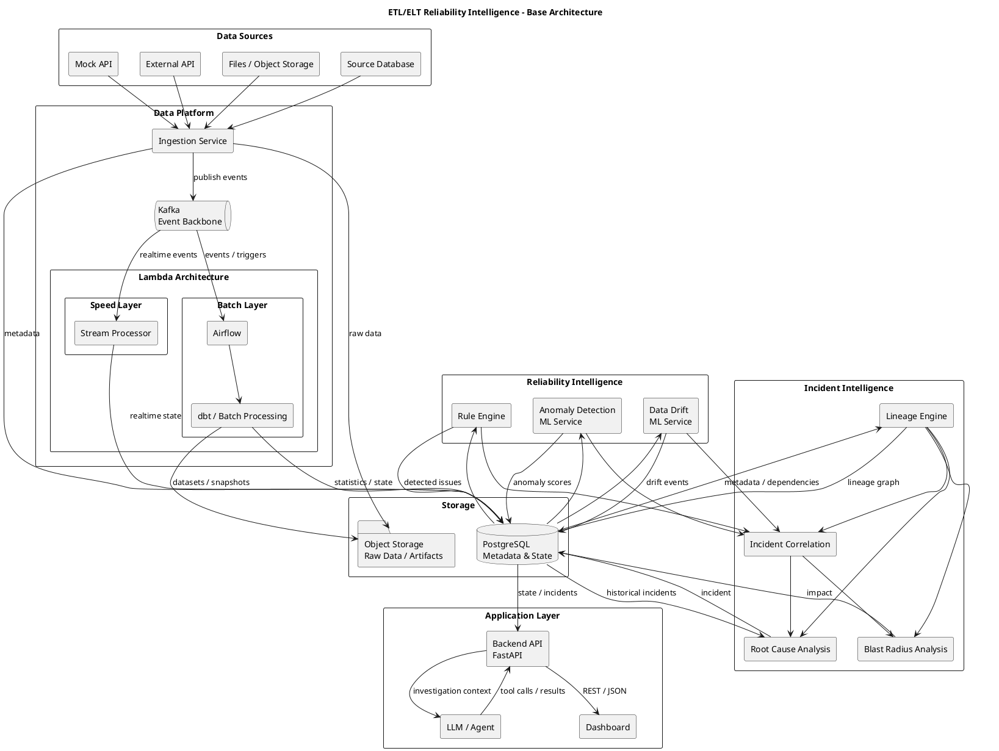

# ETL/ELT Reliability Intelligence

## 1. Назначение системы

**ETL/ELT Reliability Intelligence** — система мониторинга и анализа надёжности data-платформы.

Система получает telemetry и metadata от ETL/ELT-пайплайнов, анализирует состояние данных и pipeline execution, обнаруживает аномалии, объединяет связанные аномалии в инциденты, определяет возможные первопричины и оценивает downstream impact.

LLM/Agent используется как интерфейс для расследования инцидентов и объяснения результатов анализа.

### Основной сценарий

Например, upstream API вернул значительно меньше данных, чем обычно.

При этом:

- ingestion завершился успешно;
- Airflow DAG завершился успешно;
- dbt-модели также завершились успешно;
- но downstream dataset содержит существенно меньше записей;
- dashboard показывает некорректную выручку.

Система должна обнаружить аномалию, связать её с downstream-аномалиями и сформировать incident.

---

# 2. Архитектурные принципы

Система строится вокруг следующих принципов:

1. **Event-driven communication** между основными компонентами.
2. **Разделение batch и real-time обработки**.
3. **Отделение обнаружения аномалий от анализа инцидентов.**
4. **Lineage является частью модели системы**, а не просто визуализацией.
5. **ML не является единственным источником истины.**
6. **LLM работает поверх структурированного контекста**, а не анализирует всю систему напрямую.
7. Компоненты взаимодействуют через явно определённые контракты.
8. Каждый компонент должен иметь возможность развиваться независимо.
9. Storage и вычислительная логика разделяются.
10. Архитектура должна позволять заменять конкретные ML-модели и LLM.

---

# 3. Общая архитектура

```text
                           ┌─────────────────────┐
                           │    Data Sources     │
                           │                     │
                           │ API / Files / DB    │
                           └──────────┬──────────┘
                                      │
                                      ▼
                           ┌─────────────────────┐
                           │      Ingestion      │
                           │                     │
                           │ Validation          │
                           │ Normalization       │
                           │ Metadata extraction │
                           └──────────┬──────────┘
                                      │
                                      ▼
                           ┌─────────────────────┐
                           │       Kafka         │
                           │    Event Backbone   │
                           └──────────┬──────────┘
                                      │
                    ┌─────────────────┴─────────────────┐
                    │                                   │
                    ▼                                   ▼
          ┌─────────────────────┐             ┌─────────────────────┐
          │     Batch Layer     │             │     Speed Layer     │
          │                     │             │                     │
          │ Airflow             │             │ Stream Processor    │
          │ dbt                 │             │ Real-time rules     │
          │ Historical analysis │             │ Real-time features  │
          └──────────┬──────────┘             └──────────┬──────────┘
                     │                                   │
                     └─────────────────┬─────────────────┘
                                       ▼
                          ┌────────────────────────┐
                          │   Data / State Store   │
                          │                        │
                          │ PostgreSQL             │
                          │ Object Storage         │
                          │ Redis (optional)       │
                          └────────────┬───────────┘
                                       │
                                       ▼
                          ┌────────────────────────┐
                          │ Reliability Intelligence│
                          │                        │
                          │ Rules                  │
                          │ Anomaly Detection      │
                          │ Data Drift             │
                          └────────────┬───────────┘
                                       │
                                       ▼
                          ┌────────────────────────┐
                          │   Incident Engine      │
                          │                        │
                          │ Correlation             │
                          │ Lineage analysis        │
                          │ Root cause candidates   │
                          │ Blast radius            │
                          └────────────┬───────────┘
                                       │
                         ┌─────────────┴─────────────┐
                         ▼                           ▼
               ┌──────────────────┐        ┌──────────────────┐
               │   Backend / API  │        │   LLM / Agent    │
               │                  │        │                  │
               │ FastAPI          │◄──────►│ Investigation     │
               │ Query API        │        │ Explanation       │
               └────────┬─────────┘        └──────────────────┘
                        │
                        ▼
               ┌──────────────────┐
               │    Dashboard     │
               │                  │
               │ Incidents        │
               │ Lineage          │
               │ Pipeline health  │
               │ Data quality     │
               └──────────────────┘
```

---

# 4. PlantUML



---

# 5. Components

## 5.1 Data Sources

Источники данных, которые обрабатываются контролируемой data-платформой.

На первом этапе:

- Mock API;
- CSV/Parquet;
- PostgreSQL.

В дальнейшем могут появиться:

- реальные внешние API;
- дополнительные базы данных;
- object storage;
- streaming sources.

### Ответственность

Data Sources отвечают только за поставку данных.

Они не знают о Reliability Intelligence.

---

# 5.2 Ingestion Service

Ingestion является границей между внешними источниками и внутренней системой.

### Ответственность

- получение данных;
- базовая валидация;
- нормализация metadata;
- создание `dataset_id`;
- создание `batch_id`;
- фиксация времени получения;
- публикация событий;
- сохранение raw data.

Пример события:

```json
{
  "event_type": "dataset.ingested",
  "dataset_id": "orders",
  "batch_id": "2026-09-26-001",
  "records": 182340,
  "received_at": "2026-09-26T10:01:00Z",
  "schema_version": 3
}
```

Ingestion не должен определять, является ли dataset аномальным.

---

# 5.3 Kafka

Kafka используется как event backbone системы.

Примеры событий:

```text
dataset.ingested
pipeline.started
pipeline.finished
pipeline.failed
schema.changed
data.quality.failed
anomaly.detected
incident.created
incident.updated
```

Kafka позволяет компонентам не зависеть напрямую друг от друга.

Например:

```text
Airflow
   │
   ▼
Kafka
   │
   ├──► Speed Layer
   ├──► Reliability Intelligence
   ├──► Lineage
   └──► Storage
```

---

# 5.4 Batch Layer

Batch Layer отвечает за историческую обработку.

Основные технологии:

- Airflow;
- dbt;
- при необходимости Spark.

### Задачи

- полная обработка исторических данных;
- расчёт dataset statistics;
- построение historical baselines;
- подготовка ML features;
- периодический пересчёт lineage;
- повторная обработка данных после сбоя;
- offline evaluation ML-моделей.

Пример:

```text
Historical executions
        │
        ▼
Statistics
        │
        ▼
Historical baseline
        │
        ▼
Expected behaviour
```

---

# 5.5 Speed Layer

Speed Layer отвечает за обработку событий с минимальной задержкой.

### Задачи

- realtime anomaly detection;
- обработка pipeline events;
- расчёт оперативных метрик;
- обнаружение резких изменений;
- формирование realtime events.

Пример:

```text
10:01 → 4.8M rows
10:02 → 4.7M rows
10:03 → 1.9M rows
```

Speed Layer может немедленно создать:

```text
row_count_anomaly
```

### Batch vs Speed

| Batch                     | Speed                  |
| ------------------------- | ---------------------- |
| Историческая картина      | Текущее состояние      |
| Полный пересчёт           | Incremental processing |
| Высокая latency допустима | Низкая latency         |
| Training / baseline       | Online detection       |
| Reprocessing              | Immediate reaction     |

---

# 5.6 Data / State Store

Для базовой версии:

### PostgreSQL

Хранит:

- datasets;
- schemas;
- pipeline runs;
- anomalies;
- incidents;
- lineage metadata;
- historical metrics;
- ML model metadata.

### Object Storage

Например MinIO.

Хранит:

- raw datasets;
- Parquet;
- historical snapshots;
- ML artifacts;
- большие результаты batch processing.

### Redis

Опциональный компонент.

Может использоваться для:

- hot state;
- caching;
- realtime counters.

Redis не требуется для первой версии.

---

# 5.7 Reliability Intelligence

Центральный компонент обнаружения проблем.

На вход получает:

- pipeline telemetry;
- dataset statistics;
- historical metrics;
- schemas;
- freshness;
- execution times.

## Rule Engine

Первый уровень анализа.

Примеры:

```text
freshness > threshold
row_count < threshold
schema changed
null_rate > threshold
execution_time > threshold
```

Rules полезны для детерминированных проверок.

---

## Anomaly Detection

ML-компонент ищет отклонения от исторического поведения.

Пример:

```text
Expected:

4.5M ± 300K rows

Actual:

1.8M rows
```

Возможные модели:

- Isolation Forest;
- statistical baseline;
- time-series forecasting;
- robust z-score;
- другие модели, которые команда сможет сравнить.

Результат:

```json
{
  "dataset_id": "orders",
  "anomaly_score": 0.97,
  "detected": true,
  "model_version": "isolation-forest-v1"
}
```

---

## Data Drift Detection

Отдельная ML/statistical задача.

Сравниваются:

```text
Current distribution
        vs
Historical distribution
```

Например:

```text
payment_method

Historical:
card     70%
cash     20%
other    10%

Current:
card     20%
cash     70%
other    10%
```

---

# 5.8 Lineage Engine

Lineage Engine строит граф зависимостей.

Например:

```text
raw_orders
     │
     ▼
stg_orders
     │
     ▼
fct_orders
   ┌─┴──────┐
   ▼        ▼
revenue    LTV
```

Lineage может строиться из:

- dbt manifest;
- OpenLineage events;
- pipeline metadata.

Lineage необходим для:

- correlation;
- root cause analysis;
- blast radius;
- impact analysis.

---

# 5.9 Incident Engine

Incident Engine объединяет отдельные наблюдения в incidents.

Например, Reliability Intelligence обнаружила:

```text
orders       anomaly
stg_orders   anomaly
revenue      anomaly
customer_ltv anomaly
```

Incident Engine использует:

- временную близость;
- lineage;
- dependency graph;
- типы аномалий;
- pipeline execution history.

И создаёт:

```text
Incident #42

Candidate root cause:
orders ingestion

Affected datasets:
- stg_orders
- fct_orders
- revenue
- customer_ltv
```

---

# 5.10 Root Cause Analysis

Root Cause Analysis определяет и ранжирует возможные источники инцидента.

На вход:

```text
incident
+
anomalies
+
lineage
+
execution history
+
historical incidents
```

На выход:

```text
Candidate                    Score

orders ingestion              0.87
stg_orders transformation     0.31
revenue model                 0.12
```

Score является результатом алгоритма и не означает доказанную причинность.

В дальнейшем можно сравнить:

- rule-based RCA;
- graph-based RCA;
- ML ranking;
- LLM-assisted RCA.

---

# 5.11 Blast Radius Analysis

Blast Radius Analysis определяет, какие downstream-компоненты потенциально затронуты.

Пример:

```text
orders
   │
   ▼
stg_orders
   │
   ▼
fct_orders
 ┌─┼──────────────┐
 ▼ ▼              ▼
revenue LTV       features
  │
  ▼
dashboard
```

Если проблема обнаружена в `orders`, система может определить:

```text
Affected datasets:
- stg_orders
- fct_orders
- revenue
- LTV
- features

Potential consumers:
- revenue dashboard
- ML feature pipeline
```

Основной механизм — traversal по lineage graph.

---

# 5.12 Backend API

Backend предоставляет единый интерфейс для frontend и LLM Agent.

Рекомендуемый стек:

```text
FastAPI
Python
PostgreSQL
```

Примеры endpoints:

```http
GET /datasets
GET /datasets/{id}
GET /datasets/{id}/lineage

GET /pipelines
GET /pipelines/{id}/runs

GET /anomalies
GET /incidents
GET /incidents/{id}

GET /incidents/{id}/impact

POST /incidents/{id}/investigate
```

Frontend не должен напрямую обращаться к Kafka, ML-сервисам или внутреннему storage.

---

# 5.13 LLM / Agent

LLM находится на верхнем уровне системы.

Он не является источником telemetry и не должен самостоятельно строить всю картину data-платформы.

Agent получает структурированный контекст:

```text
Incident
+
Anomalies
+
Lineage
+
Pipeline history
+
Historical incidents
```

и имеет tools:

```text
get_incident()
get_dataset()
get_dataset_statistics()
get_lineage()
get_pipeline_runs()
search_similar_incidents()
get_blast_radius()
```

Пример:

```text
User:
Why did revenue drop?

Agent:
The most likely upstream cause is partial ingestion
of the orders dataset.

Evidence:
- input volume decreased by 61%;
- the anomaly appeared before downstream anomalies;
- revenue and LTV share the same upstream dataset;
- a similar incident occurred previously.
```

LLM отвечает за **investigation и explanation**, а не за первичный сбор и обработку telemetry.

---

# 5.14 Dashboard

Основные страницы:

## System Overview

```text
Pipelines             42
Datasets             137
Active incidents       3
Active anomalies     17
```

## Incident

```text
Incident #42

Root cause candidate
orders ingestion

Timeline
10:01 ingestion
10:02 anomaly
10:03 downstream anomaly
10:05 revenue anomaly

Blast radius
4 datasets
2 pipelines
1 dashboard
```

## Dataset

```text
orders

Current status: WARNING

Row count
Freshness
Null rate
Schema
Historical anomalies
Lineage
```

## Lineage

Граф зависимостей datasets.

---

# 6. Основные потоки данных

## 6.1 Data ingestion

```text
Data Source
    ↓
Ingestion
    ↓
Kafka
    ↓
Batch / Speed Layer
```

## 6.2 Anomaly detection

```text
Telemetry
    ↓
Feature extraction
    ↓
Rules + ML
    ↓
Anomaly
    ↓
Kafka
```

## 6.3 Incident creation

```text
Anomalies
    +
Lineage
    +
Temporal information
    ↓
Incident Engine
    ↓
Incident
```

## 6.4 AI investigation

```text
User
    ↓
Backend
    ↓
LLM Agent
    ↓
Tools
    ├── get_incident()
    ├── get_lineage()
    ├── get_statistics()
    ├── get_pipeline_runs()
    └── search_similar_incidents()
```

---

# 7. Границы ответственности

| Component                | Отвечает                    | Не отвечает                  |
| ------------------------ | --------------------------- | ---------------------------- |
| Data Source              | Поставка данных             | Анализ надёжности            |
| Ingestion                | Получение и нормализация    | Поиск аномалий               |
| Kafka                    | Передача событий            | Бизнес-логика                |
| Batch Layer              | Историческая обработка      | UI                           |
| Speed Layer              | Realtime processing         | RCA                          |
| Storage                  | Хранение состояния          | Выводы о причинах            |
| Reliability Intelligence | Обнаружение отклонений      | Определение полного incident |
| Lineage Engine           | Зависимости                 | Объяснение пользователю      |
| Incident Engine          | Correlation / incidents     | UI                           |
| Root Cause Analysis      | Кандидаты причин            | Сбор telemetry               |
| Blast Radius             | Downstream impact           | ML anomaly detection         |
| Backend                  | API / orchestration         | Data analysis                |
| LLM Agent                | Investigation / explanation | Source of truth              |
| Dashboard                | Visualization               | Business logic               |

---

# 8. Начальная версия

Необходимо избежать преждевременного создания большого количества микросервисов.

Для MVP достаточно:

```text
Data Source
     ↓
Ingestion
     ↓
Kafka
     ↓
Airflow + dbt
     ↓
PostgreSQL
     ↓
Reliability Service
     ↓
Incident Engine
     ↓
FastAPI
     ↓
Dashboard
```

На первой итерации ML может быть минимальным или отсутствовать.

Например:

```text
row_count < expected * 0.7
        ↓
anomaly
```

После появления исторических данных rule-based подход можно заменить или дополнить ML.

---

# 9. Эволюция архитектуры

Архитектура предполагает постепенное развитие.

### Iteration 1

```text
Pipeline works
```

### Iteration 2

```text
Pipeline
    ↓
Telemetry
    ↓
Basic anomalies
```

### Iteration 3

```text
Anomalies
    +
Lineage
    ↓
Incident
```

### Iteration 4

```text
Incident
    ↓
Root cause
    +
Blast radius
```

### Iteration 5

```text
Historical data
    ↓
ML anomaly detection
```

### Iteration 6

```text
Historical incidents
    ↓
Similarity search
```

### Iteration 7

```text
Incident graph
    ↓
LLM Agent
    ↓
Investigation
```

---

# 10. Планируемое разделение команды

## Participant 1 — Data Platform

Ответственность:

- Data Sources;
- Ingestion;
- Airflow;
- Kafka;
- ETL/ELT pipeline.

## Participant 2 — Processing & Storage

Ответственность:

- Batch Layer;
- Speed Layer;
- PostgreSQL;
- Object Storage;
- dataset statistics.

## Participant 3 — Reliability Intelligence

Ответственность:

- Rule Engine;
- anomaly detection;
- data drift;
- ML experiments;
- feature engineering.

## Participant 4 — Incident Intelligence & Application

Ответственность:

- Lineage;
- Incident Engine;
- root cause;
- blast radius;
- Backend;
- LLM Agent.

Все участники должны понимать всю систему, несмотря на разделение ownership.

---

# 11. Архитектурные вопросы для дальнейших итераций

По мере развития проекта необходимо будет ответить на следующие вопросы:

1. Где должна находиться ответственность за schema validation?
2. Kafka event является source of truth или только transport?
3. Как синхронизировать Batch и Speed Layer?
4. Как разрешать расхождения между batch и realtime state?
5. Где хранить lineage graph?
6. Как версионировать ML-модели?
7. Как оценивать качество anomaly detection?
8. Как отличать anomaly от incident?
9. Как оценивать качество root cause analysis?
10. Как определять blast radius при неполном lineage?
11. Когда Reliability Service нужно разделять на несколько сервисов?
12. Какие компоненты должны масштабироваться независимо?
13. Что произойдёт при потере Kafka events?
14. Что произойдёт при недоступности ML Service?
15. Что произойдёт при ошибочном prediction ML-модели?
16. Как система будет обрабатывать schema evolution?
17. Как обеспечить идемпотентность повторной обработки событий?
18. Как LLM получает только необходимый контекст?
19. Как проверять утверждения, сделанные LLM?
20. Какие части системы должны оставаться deterministic?

Эти вопросы являются частью дальнейшего проектирования и могут становиться предметом отдельных итераций проекта.
